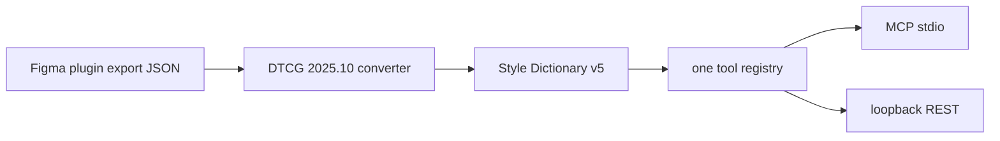

# Figma brand rules demo

A fictional, local demonstration of Figma Variables-shaped JSON flowing through DTCG 2025.10 and Style Dictionary v5 to CSS, resolved typed server JSON, ASE, and three Preview MCP/REST tools. It is not a product or hosted service.

Use Node 22: `npm ci --ignore-scripts && npm run build && npm run pipeline && npm test`. Copy `.env.example` to `.env` for synthetic local credentials; never commit real credentials. Run REST with `node --env-file=.env dist/src/main.js rest` (loopback only), or the stdio MCP entry with `node --env-file=.env dist/src/main.js`. Stdio writes only MCP JSON-RPC: Style Dictionary build logging is silenced during server startup.

For REST, use `curl -X POST http://127.0.0.1:3000/tools/check_color_pair -H 'Authorization: Bearer synthetic-alpha-key' -H 'content-type: application/json' -d '{"brand":"alpha","fg":"semantic.color.text","bg":"semantic.color.background","text_size":"normal"}'`.

`npm run pipeline` writes ignored artifacts and `artifacts/snapshot.json`. Generate a changelog with `npm run changelog -- before.json after.json 0.1.0`. Additions are minor; changed or removed tokens/rules are major; unchanged snapshots retain the supplied version.

Claude Code/Desktop MCP clients must start this command with the repository as their current working directory, because the fictional fixture paths are deliberately relative. This is a client launch setting, not shared workspace infrastructure.

An ordinary Figma account with edit access can use a manually invoked Plugin API exporter: call `figma.variables.getLocalVariablesAsync()` and `getLocalVariableCollectionsAsync()` in the open file, serialize collections (`modes`, `defaultModeId`, `variableIds`) and variables (`variableCollectionId`, `resolvedType`, `valuesByMode`), including `{ type: "VARIABLE_ALIAS", id }` values, then replace only fictional local fixture data. Collection modes are matched by name, never ID. Figma REST Variables is not used because it is Enterprise-only.

Out of scope: OAuth, governance, page checking, hosting, real brands/client data, production deployment, and any tools beyond `get_tokens`, `get_rule`, and `check_color_pair`.
